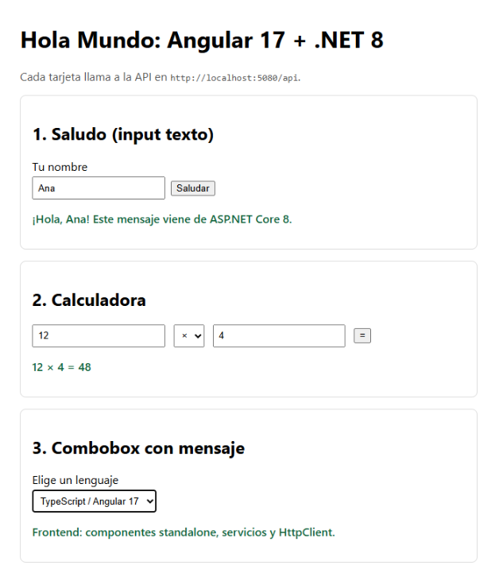

# Hola Mundo · .NET 8 + Angular 17

[](https://github.com/VicentePerezHdz/holamundo-netcore-angular/actions/workflows/ci.yml) [](LICENSE)

API REST en capas con ASP.NET Core y un frontend en Angular que la consume. Tiene tres funciones: saludo con input de texto, calculadora y combobox con mensaje.



## Qué demuestra
- **Backend:** controladores, servicios e interfaces, inyección de dependencias, validación, errores con `ProblemDetails` (middleware global), CORS, Swagger y cancelación con `CancellationToken`.
- **Frontend:** componentes standalone, signals, `HttpClient` y un servicio de API tipado.

## Cómo correrlo
```powershell
# API: http://localhost:5080 (Swagger en /swagger)
cd backend\HolaMundo.Api
dotnet run --launch-profile http

# Web: http://localhost:4200
cd holamundo-web
npm install
npm start
```

## Pruebas
```powershell
cd backend; dotnet test                                                  # 9 pruebas xUnit
cd holamundo-web; npx ng test --watch=false --browsers=ChromeHeadless   # 2 pruebas Jasmine
```

La explicación completa (arquitectura, recorrido de una petición, inventario de clases) está en [`docs/Documento_Transicion.md`](docs/Documento_Transicion.md).

## Licencia

[MIT](LICENSE)
